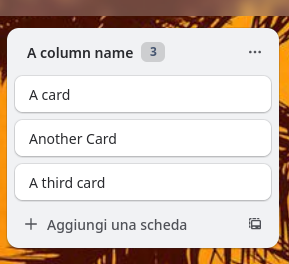

# trello extras

A Firefox extension that shows the card counter on every Trello list.

The counter badge appears inline with the list title, making it easy to see at a glance how many cards are in each column.

## Install

[Add to Firefox](https://addons.mozilla.org/en/firefox/addon/trello-extras/)